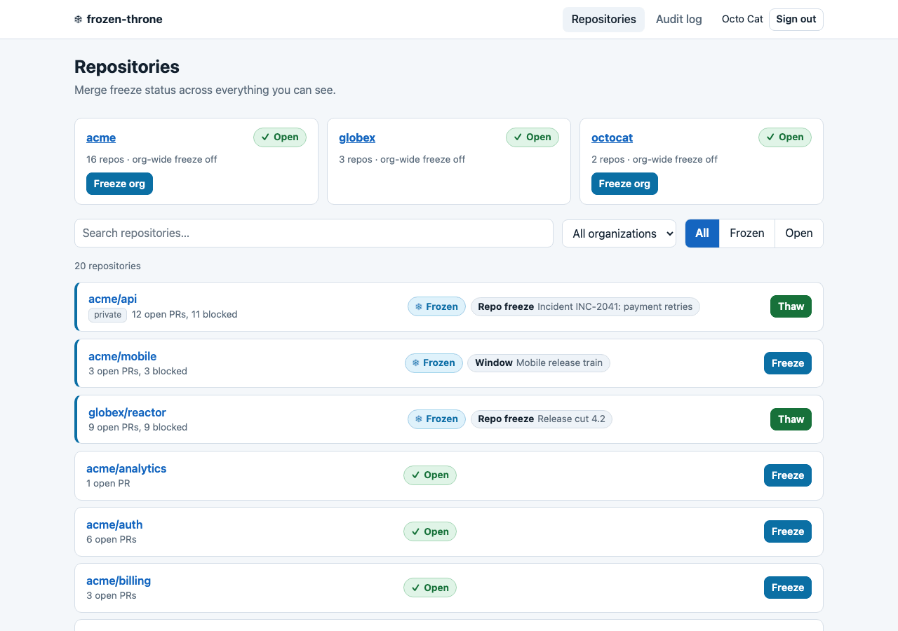
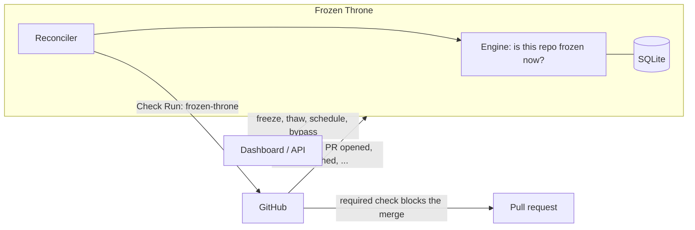

# Frozen Throne

**Self-hosted merge freezes for GitHub.** Flip a repo (or a whole org) to
"frozen" and every open pull request stops being mergeable, with a clear
reason, an audit trail and an escape hatch for the one PR that really must
ship.

Frozen Throne is for platform and release teams who want code freezes (release
cuts, incident response, holidays, "nobody is on call on Fridays") enforced by
GitHub itself rather than by a Slack message everybody forgets. It is one
container (or one static binary) and one SQLite file. No external services
beyond GitHub.



*More: [repo detail page](docs/images/repo-detail.png) with the freeze reason,
bypasses, freeze windows and recent activity.*

## How it works



- A **GitHub App** receives pull request events and posts a Check Run named
  `frozen-throne` on every PR: failing ("Frozen") while a freeze applies,
  passing otherwise.
- You mark that check **required** in branch protection (or a ruleset, or the
  merge queue). That is the whole enforcement mechanism.
- **Any active freeze blocks.** A repo is frozen if its org is frozen, the repo
  itself is frozen, or a schedule window is active. A repo cannot override an
  org freeze.
- **Schedules** are one-off or recurring windows (weekdays, times, timezone)
  at repo or org level. They freeze at the start and thaw at the end on their
  own.
- **Bypass** exempts a single PR, requires a reason, survives new pushes and is
  cleared when the freeze ends or the PR merges or closes.
- **Reconcile heals stale state.** Window boundaries, freeze changes and a
  periodic sweep (`FT_RECONCILE_INTERVAL`, default 5m) re-evaluate every repo,
  so a missed webhook or a restart never leaves a check wrong for long.

## Quickstart (about 5 minutes)

You need Docker, a public HTTPS URL for the server, and permission to create a
GitHub App in the org. Full details are in [docs/setup.md](docs/setup.md).

1. **Create the GitHub App** with the permissions, events, webhook URL
   (`<url>/webhooks/github`) and callback URL (`<url>/api/v1/auth/callback`)
   from [setup step 1](docs/setup.md#1-create-the-github-app). Note the App
   ID, client ID, a client secret, the webhook secret, and download the
   private key.
2. **Configure and start the server** (variables are described in
   [docs/configuration.md](docs/configuration.md)):

   ```sh
   cp docker-compose.example.yml docker-compose.yml
   cp .env.example .env
   mv ~/Downloads/<app>.private-key.pem ./github-app.private-key.pem
   chmod 644 github-app.private-key.pem   # the container runs as uid 65532
   $EDITOR .env                            # values from step 1
   docker compose up -d
   curl http://localhost:8080/healthz      # {"status":"ok"}
   ```

   Put a TLS-terminating reverse proxy in front at `FT_BASE_URL`
   ([details](docs/setup.md#put-https-in-front)).
3. **Install the App** on your organization. A `frozen-throne` check
   appears on every open PR, green while thawed.
4. **Mark the check required**: branch protection on your default branch →
   *Require status checks to pass* → add `frozen-throne`
   ([details](docs/setup.md#4-require-the-check-in-branch-protection)).
5. **Freeze a repo**: open the dashboard at your URL, log in with GitHub and
   press **Freeze** next to a repo. Its PRs flip to a failing
   `frozen-throne` check within seconds; **Thaw** turns them green again.

Prefer a binary? Releases carry static `frozen-throne-<os>-<arch>` builds
(linux and darwin, amd64 and arm64) with the dashboard embedded; the image is
`ghcr.io/thejokersthief/frozen-throne`.

## Features

- Manual freeze and thaw per repo or per organization, with a reason.
- Scheduled freezes: one-off and recurring windows with timezones, at repo or
  org level (org-wide windows also cover repos added later).
- Per-PR bypass with a recorded reason.
- Check Runs on pull requests and merge queue (`merge_group`) events.
- Web dashboard: repos at a glance with search and filters, repo and org pages,
  audit log. Permissions are checked live against GitHub with the user's own
  token.
- Audit log of every freeze, thaw, schedule and bypass.
- Optional Slack notifications for freeze, thaw and bypass (per org).
- Many GitHub installations served by one deployment.
- REST API described by [`api/openapi.yaml`](api/openapi.yaml).
- Self-healing reconcile loop; embedded forward-only SQLite migrations.

## Status and badges

Repos can opt in to a public, unauthenticated status endpoint (toggle
*Public status* on the repo page; it exposes no reasons or PR data):

```md

```

JSON status: `GET /api/v1/public/repos/OWNER/REPO/status`. Server liveness:
`GET /healthz`.

## Documentation

- [Self-hosting guide](docs/setup.md): GitHub App, running, branch protection,
  troubleshooting.
- [Configuration reference](docs/configuration.md): every environment variable
  and endpoint.
- [CONTRIBUTING.md](CONTRIBUTING.md): repo layout, dev setup, tests, the API
  contract workflow, refreshing the screenshots.

## Contributing

Issues and small, focused pull requests are welcome. Start with
[CONTRIBUTING.md](CONTRIBUTING.md).

## License

MIT, see [LICENSE](LICENSE).
